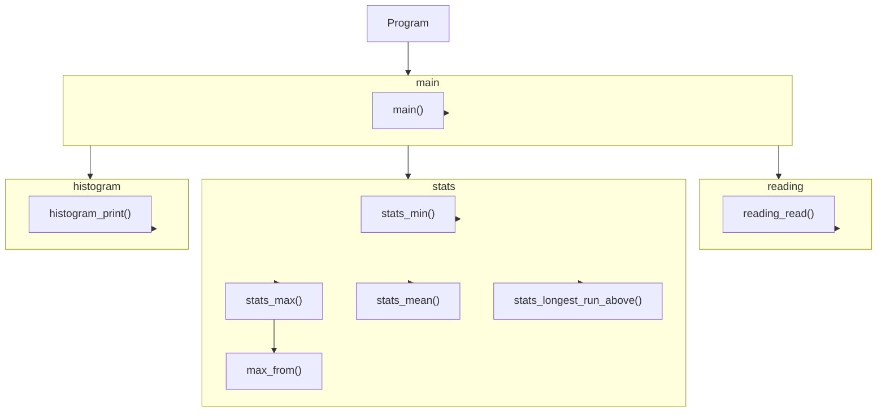

## Building

From this directory, build the program with:

```sh
make
```

## Testing

After building, run the tests with:

```sh
make test
```

The test command reports failures and exits unsuccessfully if any test does not pass.

## Cleaning

Remove build artifacts with:

```sh
make clean
```

## Module Diagram


