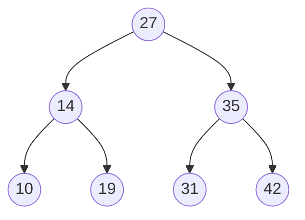
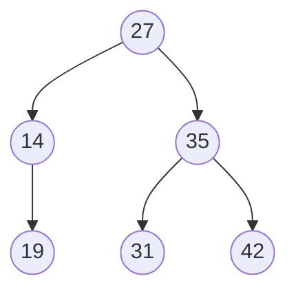
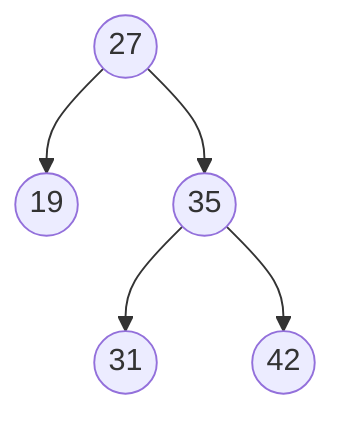
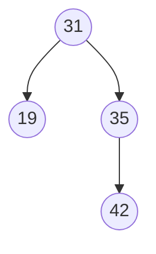

# Bonus — bst_remove

## Original seven-key tree

Insertion order `27 14 35 10 19 31 42` gives:

## After removing 10 (leaf)

`10` is a leaf — zero children. It is simply unlinked from its parent
(`14`'s left child becomes NULL) and freed.

## After removing 14 (one child)

`14` has only a right child (`19`). The child is spliced into `14`'s
place: `27`'s left child becomes `19`. One node freed.

## After removing 27 (two children)

`27` has two children. The smallest key of its right subtree is `31`
(the leftmost node under `35`). Copy `31` into the root, then remove
the original `31` node, which has no left child (zero/one-child case).
One node freed.

